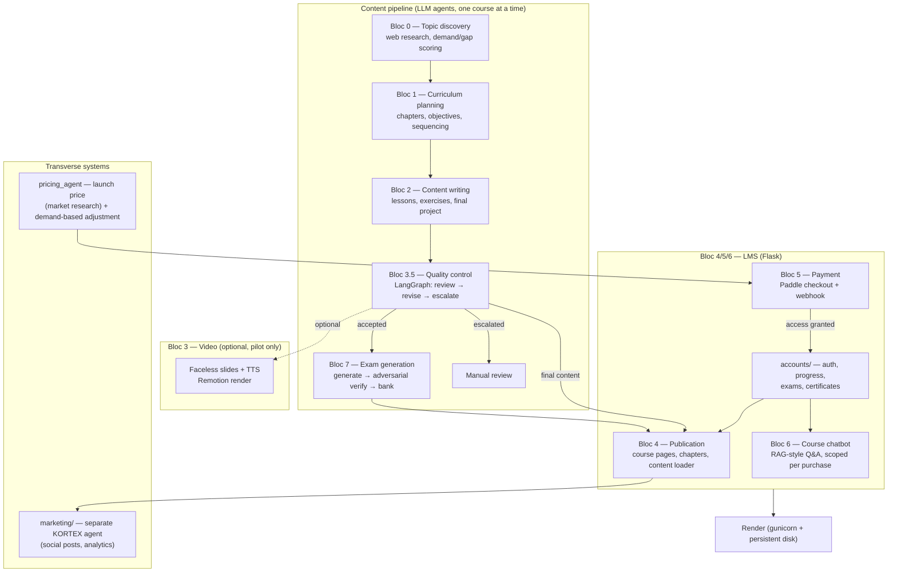
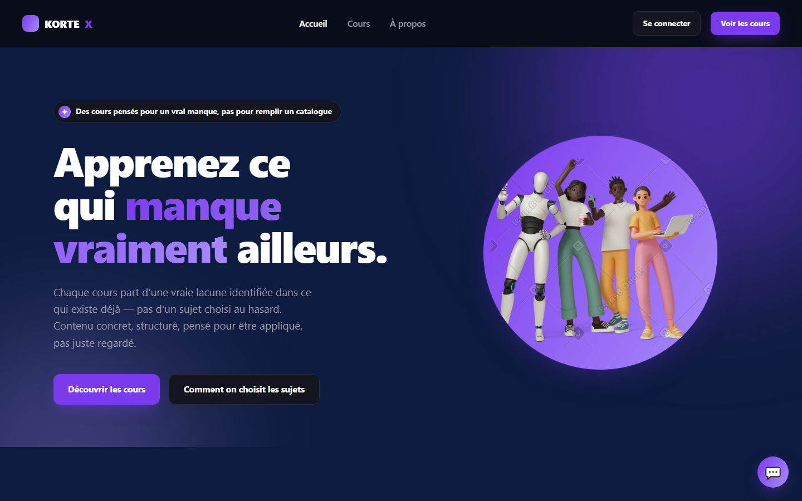
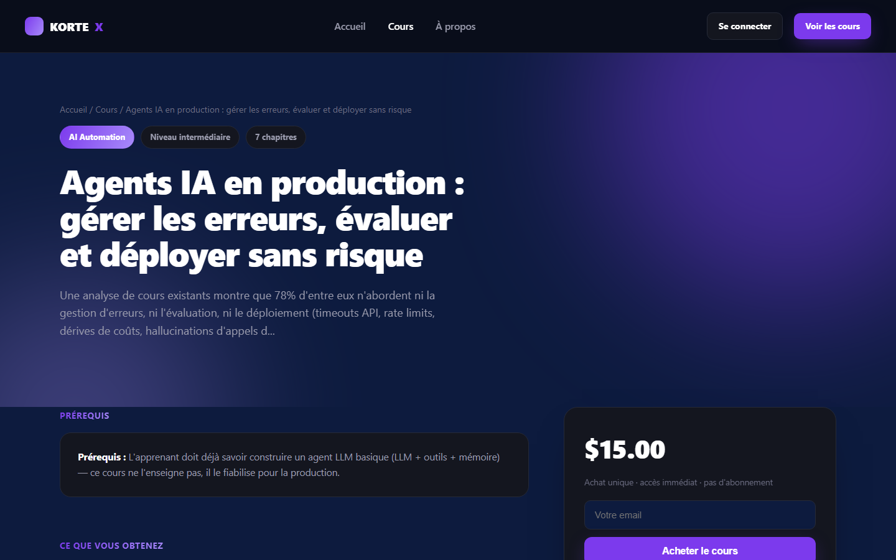
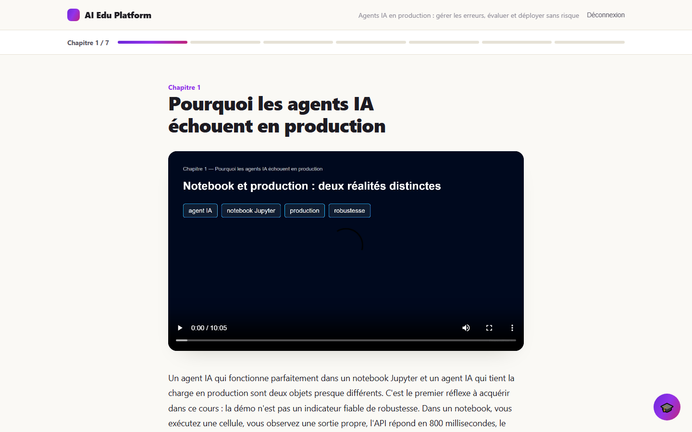
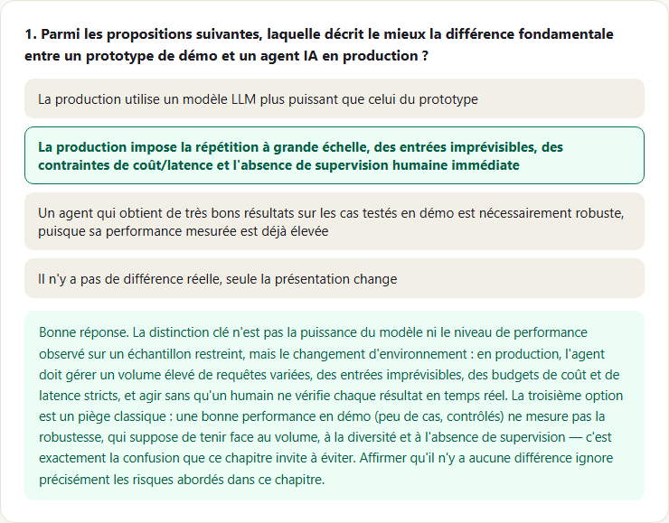
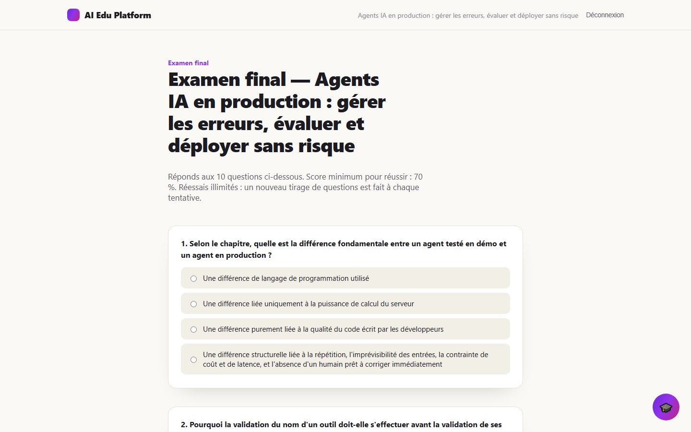
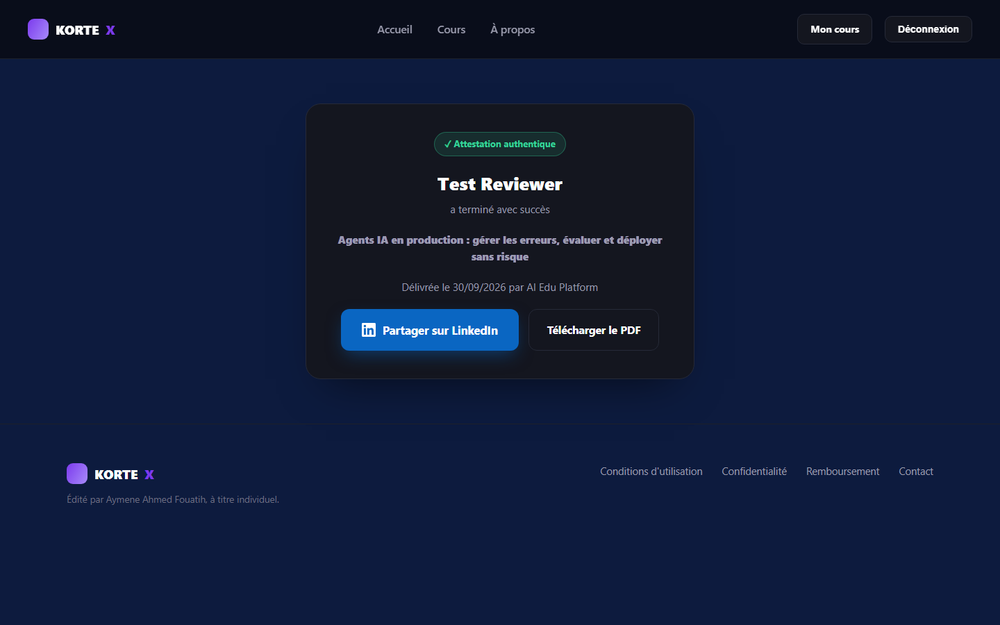

# KORTEX — AI Edu Platform

Built solo by Aymen Fouatih, telecommunications engineer (ENSTTIC, Algeria).

An online course platform where the entire content pipeline — topic discovery, curriculum
design, lesson/exercise writing, quality control, exam generation, and a support chatbot — is
built and run by orchestrated LLM agents, sitting behind a self-built LMS with real payments,
accounts, progress tracking, and certificates.

**Status: working prototype.** It was deployed to production with real payments (Paddle), and
the deployment is now paused. This repository is shared for code review — see
[Status & roadmap](#status--roadmap) for what's actually working vs. still open.

This is a **trimmed, public copy** of a private, actively-developed repository. See
[Known limitations](#known-limitations) for exactly what was removed and why.

## What it does

Each course is meant to leave the learner with an applied skill, not a passive video watch:
every course ships as chapters of lesson text + comprehension exercises + one practical
exercise per chapter + a final project, plus a graded exam and a certificate on completion.
Courses are chosen because they fill a gap the agent finds in what already exists online (with
its sourced reasoning kept alongside the pick), not picked off a generic topic list.

Two courses were published: an AI-agents-in-production course (reliability/error-handling) and
an AI/agent security course (prompt injection, shadow AI, IAM governance).

## Status & roadmap

**Working, built and verified for real (not just passing mocked tests):**
- The content pipeline (Bloc 0→1→2→3.5) ran end-to-end for real to produce both published
  courses (7 chapters each, all reaching the quality-control acceptance bar), and was separately
  proven reproducible on a third, unpublished topic to validate that the QC mechanism
  generalizes rather than just happening to work once (see [Real results](#real-results)).
- Exam generation + adversarial verification (Bloc 7) ran for real on both published courses.
- The LMS, accounts (email/password + Google OAuth), payment (Paddle, Merchant of Record), and
  chapter-unlock flow were deployed to production and processed real transactions — checkout,
  webhook confirmation, and access grant were all exercised with real requests, not just the
  pytest suite.
- Certificates (PDF generation + public verification) and per-chapter progress tracking are
  implemented and covered by the test suite.
- The pricing agent's launch-price research ran for real (see the market numbers below); the
  demand-based adjustment phase has only been exercised with mocked sales data so far.

**Deliberately not finished / open:**
- **The video pilot (Bloc 3) never shipped.** One pilot video exists for course 1's first
  chapter; the rest of both courses ship as text + exercises only. The richer visual style
  explored in later pilots wasn't good enough by launch, so video was cut from the v1 scope
  rather than delaying the launch.
- **The deployment is currently paused**, by choice — this is a solo-built commercial project at
  prototype stage, not an abandoned one.
- **No transactional email**: the purchase access link is shown on the success page and logged
  server-side, not emailed.
- **2 of 6 configured domains actually published.** The autonomous scheduler
  (`pipeline/scheduler_config.json`) is configured for 6 technical domains — AI & Automation,
  DevOps & Cloud, Cybersecurity, Web Development, Networking & Telecom, Data Science — and the
  pipeline has produced accepted content in 2 of them (the two published courses). The
  reproducibility test (see below) reused a different, unpublished topic within AI Automation
  itself, chosen specifically to be far from course 1 in subject matter (business/sales rather
  than technical reliability), not a test of a different domain. The other 4 configured domains
  are covered by tests but have no published course yet — not proven at scale.

## Architecture

The system is organized as a numbered pipeline (blocks 0–7, each independently runnable),
feeding a Flask LMS that handles accounts, payment, and delivery.



- **Bloc 0 — Topic discovery** (`bloc0_topic_discovery/`): web research via the Claude Agent SDK
  + WebSearch tool, ranks candidate topics by a demand/content-gap score.
- **Bloc 1 — Curriculum planning** (`bloc1_curriculum_planning/`): turns one selected topic into
  a full chapter structure (objectives, key points, level/prerequisites), with a logical-sequence
  check between chapters.
- **Bloc 2 — Content writing** (`bloc2_content_writing/`): writes the lesson script,
  comprehension exercises, and a practical exercise per chapter (final chapter also gets the
  capstone project). Also exposes the targeted rewrite function called by Bloc 3.5.
- **Bloc 3.5 — Quality control** (`bloc3_5_quality_control/`): an independent reviewer (separate
  prompt/logic from the writer, so it can't rubber-stamp its own output) runs each chapter
  through a **LangGraph** state machine — `review → accept`, `review → revise → review`, or
  `review → escalate` after a capped number of correction attempts. No chapter reaches the LMS
  without passing this gate or being escalated for manual review.
- **Bloc 3 — Video production** (`bloc3_video_production/` + `remotion/`): faceless slides + TTS
  (ElevenLabs) rendered with Remotion. Built through several pilots (static slides → animated →
  diagram-based visuals); **shelved before the richer visual style was good enough** — see
  limitations.
- **Bloc 4 — Publication** (`bloc4_publication/`): merges the validated curriculum + final
  content into the site (catalog, landing pages, chapter reader).
- **Bloc 5 — Payment** (`bloc5_payment/`): Paddle (Merchant of Record) checkout + webhook
  (HMAC-SHA256 verified), auto-switches between mock and live mode based on whether Paddle keys
  are configured, and never does so silently.
- **`accounts/`**: email/password + Google OAuth login, per-chapter progress tracking, graded
  exams (`bloc7_exam_generation/` bank), PDF certificate generation (`reportlab`) with public
  verification.
- **Bloc 6 — Course chatbot** (`bloc6_chatbot/`): answers learner questions, scoped to the
  course they actually purchased (access-checked before the model ever sees the question).
- **Bloc 7 — Exam generation** (`bloc7_exam_generation/`): generates candidate MCQ questions per
  chapter, then runs each one through a second, independent adversarial verifier before it's
  allowed into the exam bank (see real numbers below).
- **`pricing_agent/`**: two-phase pricing — a launch price informed by real web research into
  comparable courses (a fixed business constant, not an LLM output), and a demand-based
  adjustment phase with a hard ceiling.
- **`marketing/`**: a separate, second agent system (not part of the numbered pipeline) that
  drafts and publishes social content from course material.

## Technologies

- **Claude Agent SDK** (`claude-agent-sdk`, CLI subscription session via `claude login`) — only
  where a WebSearch tool call is actually needed: Bloc 0 topic discovery, the pricing agent's
  market research, and the Bloc 3 video-slide planner (pilot only). This only works on a machine
  with a logged-in CLI session, so it's confined to scripts run locally, never to code that
  serves a production HTTP request.
- **Anthropic API direct** (`anthropic`, metered `ANTHROPIC_API_KEY`, with a `CostTracker` that
  logs real input/output tokens and estimated cost per call) — Bloc 1 (curriculum), Bloc 2
  (content writing), Bloc 3.5 (the independent reviewer), Bloc 6 (chatbot), Bloc 7 (exam
  generation + verification), and the Bloc 4 exercise/practical-exercise correction. The last one
  specifically *can't* use the CLI session: it runs inside a Flask route served by Render in
  production, a headless server with no logged-in browser session for the CLI to reuse.
- **Google Gemini** (optional, routed automatically by `pipeline/cost_controller.py` for select
  tasks while its free quota lasts, falling back to Claude Haiku once it's exhausted) — used
  opportunistically by the autonomous scheduler, not by the courses published so far.
- **LangGraph** — the bounded review/revise/escalate state machine in Bloc 3.5.
- **Flask** + **gunicorn** — the LMS and all HTTP routes; **SQLAlchemy** for accounts/progress
  storage; **Authlib** for Google OAuth; **reportlab** for certificate PDFs.
- **Paddle** — payment processing as Merchant of Record (handles tax/VAT reselling).
- **ElevenLabs** (TTS, with the `with-timestamps` alignment endpoint) + **Remotion** (React/Node
  video rendering) — Bloc 3 pilot only.
- **pytest** — the full automated test suite (see results below).
- **Render** — hosting, with a persistent disk for runtime state (access grants, pricing state,
  sales log) that's explicitly never part of the git repo.

Deliberately **not used**, despite being in the original project brief: n8n, Airtable,
LangChain. A single course is processed at a time with an explicit human checkpoint between
each block, which didn't justify the extra orchestration/tracking layer those would add — see
`docs/PROJECT_BRIEF_FR.md` for the original scope and the in-code docs for where the build
diverged from it and why.

## Key technical choices

- **The CLI subscription session (`claude login`) is used only where nothing else can work**
  (local scripts needing the WebSearch tool); everything that has to run as part of a live HTTP
  request in production goes through the metered Anthropic API instead, with real per-call cost
  tracking (`common/llm_client.py::CostTracker`) — see [Technologies](#technologies).
- **Bloc 2's system prompt explicitly forbids presenting a fabricated number as fact**: any
  illustrative statistic or example calculation must be flagged as illustrative in the text
  itself, never stated as if sourced — checked by the Bloc 3.5 reviewer, not just requested.
- **The Bloc 3.5 reviewer is architecturally separate from the Bloc 2 writer** — different
  prompt, different responsibility, called independently — specifically so the system can't
  grade its own homework.
- **Exam questions pass through a second, adversarial verifier before entering the bank**
  (`bloc7_exam_generation/question_verifier.py`): it never sees the generator's proposed correct
  answer or explanation, resolves the question independently from the course content alone, and
  any disagreement with the generator is an automatic rejection — along with checks for
  unanswerable-from-course-content, multiple defensible answers, weak distractors, and ambiguous
  wording. Real rejection reasons from an actual run are in the results below.
- **The Paddle webhook verifies the HMAC-SHA256 signature** on every incoming request before
  trusting it as a real payment confirmation (`bloc5_payment/paddle_client.py::
  verify_webhook_signature`) — the check is skipped only in mock mode (no webhook secret
  configured), and that fallback is logged, never silent.
- **Uploaded exercise files are never written to disk**: read into memory, checked against a
  file-type allowlist by their actual magic bytes (not the declared extension), size-capped, and
  discarded after the request. The learner's submitted answer is always treated as data for the
  grading prompt, never as an instruction to the model, regardless of what it contains.
- **A certificate is issued only if all three hold, checked server-side**: the email has paid for
  this course, every chapter is explicitly marked complete with every exercise answered, and the
  learner has passed the final exam at least once (≥70%). Not eligible yet redirects to an
  honest "not there yet" page rather than a silent no-op.
- **The exam is graded by comparing the chosen answer's text to the bank's text, never by index**
  (`accounts/exam_grading.py`) — options are reshuffled on every attempt, and the correct index
  never has to (and never does) round-trip through the client.
- **Bloc 5 makes its mock/live status explicit** (`bloc5_payment.config.is_mock_mode()`),
  announced at server startup and in webhook logs — never a silent fallback to demo behavior.
- **Runtime state (access grants, pricing, sales log, learner progress) lives on Render's
  persistent disk, never in git** — the repo holds code and validated content only.
- **The launch price is a fixed business constant, not an LLM output.** The agent's web research
  only produces market context and reasoning; a human confirms the actual number (see below).

## Real results

- **Test suite: 847/847 passing** (`pytest`, run from a clean install of this exact snapshot —
  see [Verifying this yourself](#verifying-this-yourself)). Every call to the LLM, TTS, and
  Paddle APIs is mocked in the suite; nothing here costs money or makes a network call.
- **Quality control (Bloc 3.5), course 1** (agents-in-production): initial automatic pass
  accepted 3/7 chapters outright, escalated 4/7 after exhausting correction attempts; **7/7
  accepted** after 4 rounds of targeted, reviewer-driven correction.
- **Quality control reproducibility test**, run on a third, unpublished topic — deliberately
  unrelated to both published courses (business/sales rather than technical) — to check the
  mechanism generalizes rather than just not crashing: **50% of chapters escalated vs. 57% on
  course 1** — a near-identical rate on unrelated content, which is the reproducibility signal
  that mattered, not a lower bar.
- **Exam generation + verification, course 1**: 35 questions generated, **35/35 retained**, 0
  rejected — cost of the run: 43 LLM calls, **≈$1.10** (metered Anthropic API).
- **Exam generation + verification, course 2**: 49 questions generated, **39/49 retained** (7
  rejected by the adversarial verifier, 3 set aside only to balance the per-chapter quota). Real
  rejection reasons from that run: `multiple_defensible_answers` (7),
  `distractor_not_clearly_wrong` (7), `ambiguous_wording` (4) — a question can trigger more than
  one. This run's cost logged as **$0.0000** for 56 calls — not a free run, a **cost-tracking
  bug**: the model-routing layer (`pipeline/cost_controller.py`) referred to the model by an
  undated alias (`claude-haiku-4-5`) missing from the pricing table, so `estimate_cost_usd()`
  silently returned 0 while the calls were still real, metered, and billed. The alias is now in
  the pricing table (`common/llm_client.py::MODEL_PRICING_PER_MILLION_TOKENS`) — a real bug found
  and fixed, not a cost-saving technique.
- **Pricing**: the launch-pricing agent's real web research found 6 comparable courses ranging
  $0–$4,200 depending on format (median ≈$102 for the comparable async-video format); its own
  reasoning suggested a "cautious" $10–$30 given the catalog was still incomplete at the time.
  The confirmed launch prices are **$15** (course 1) and **$19** (course 2).

There is no single tracked "cost per course" figure covering the whole pipeline — the two exam-
generation numbers above are the real, measured ones that exist; other steps (curriculum, content
writing, quality control) use the same metered API and cost-tracking mechanism but weren't pulled
out per-course for this write-up.

## Screenshots

Captured locally from this exact codebase running in mock mode (no real payment/LLM keys), using
a test account seeded with mock course access — the same access a real Paddle purchase grants.

**Home**


**Course page**


**Chapter**


**Exercise** (comprehension MCQ, graded client-side, with explanation)


**Exam**


**Certificate**


## Known limitations

- **This is a trimmed copy, not the production dataset.** `data/` here contains exactly one
  example chapter (curriculum + lesson content + its exam questions) from the security course,
  to illustrate the data shapes the pipeline produces — not the paid course content. The private
  repository this was copied from holds the full data; it is intentionally not public.
- **Not directly runnable end-to-end from this repo.** The code expects a full course dataset
  and the original provider API keys to run beyond mock mode — none of which ship here. The
  screenshots above were captured by running this exact code locally in mock mode; use this repo
  to read the implementation.
- **The video pilot (Bloc 3) is shelved, not shipped.** Faceless-slide videos went through
  several visual iterations (static → animated → diagram-based) but the richer style wasn't good
  enough by launch; the product decision was to launch on lesson content + exercises + exam
  first, with video reconsidered post-launch — neither published course leads with video.
- **Only 2 of 6 configured domains have a published course.** The scheduler is built and tested
  for AI & Automation, DevOps & Cloud, Cybersecurity, Web Development, Networking & Telecom, and
  Data Science, but only AI & Automation and Cybersecurity have produced a course that actually
  shipped — the other 4 are configured and covered by tests, not proven with real output.
- **No transactional email yet.** The purchase access link is shown on the success page and
  logged server-side; there's no SMTP integration, so nothing is emailed to the buyer yet.
- **ElevenLabs TTS quota is a real constraint**, not just a video-quality one — a single
  ~10-minute chapter consumes a large share of a 10,000-credit free-tier quota, which limited how
  much video iteration was practical.

## Verifying this yourself

```bash
python -m venv venv
./venv/Scripts/pip install -r requirements.txt      # Windows; use venv/bin/pip on macOS/Linux
./venv/Scripts/python -m pytest -q
```

This should reproduce 847 passing tests with zero network calls and zero cost — everything
touching an LLM, TTS, or payment provider is mocked.

## Author

Aymen Fouatih, telecommunications engineer (ENSTTIC, Oran, Algeria), working on LLM agents and
RAG systems. Contact: contact@aymen-automation.site.

## License

All rights reserved — see [LICENSE](LICENSE). This repository is public for portfolio/review
purposes; it is not licensed for reuse.
